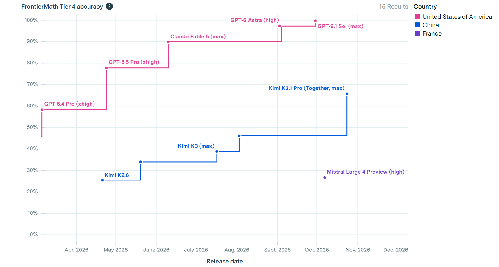
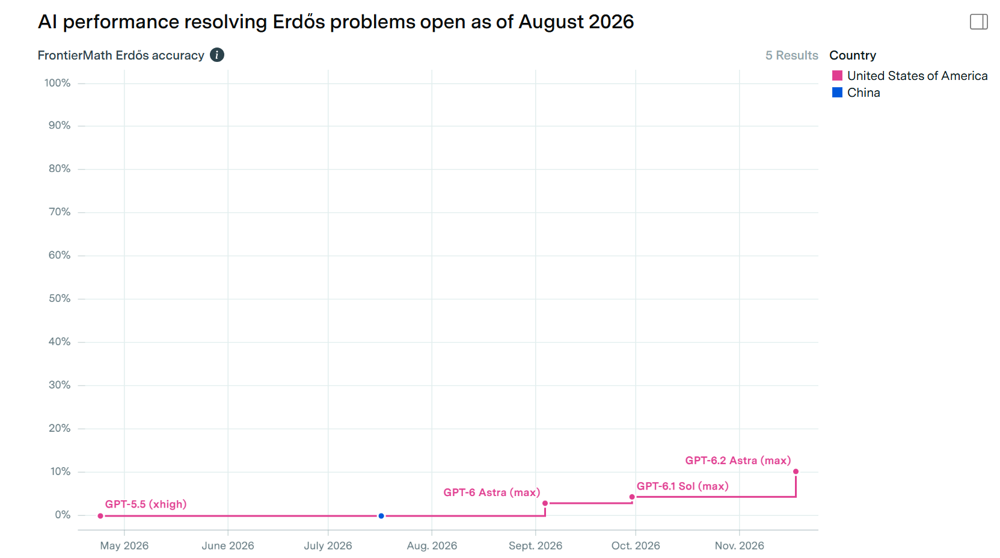
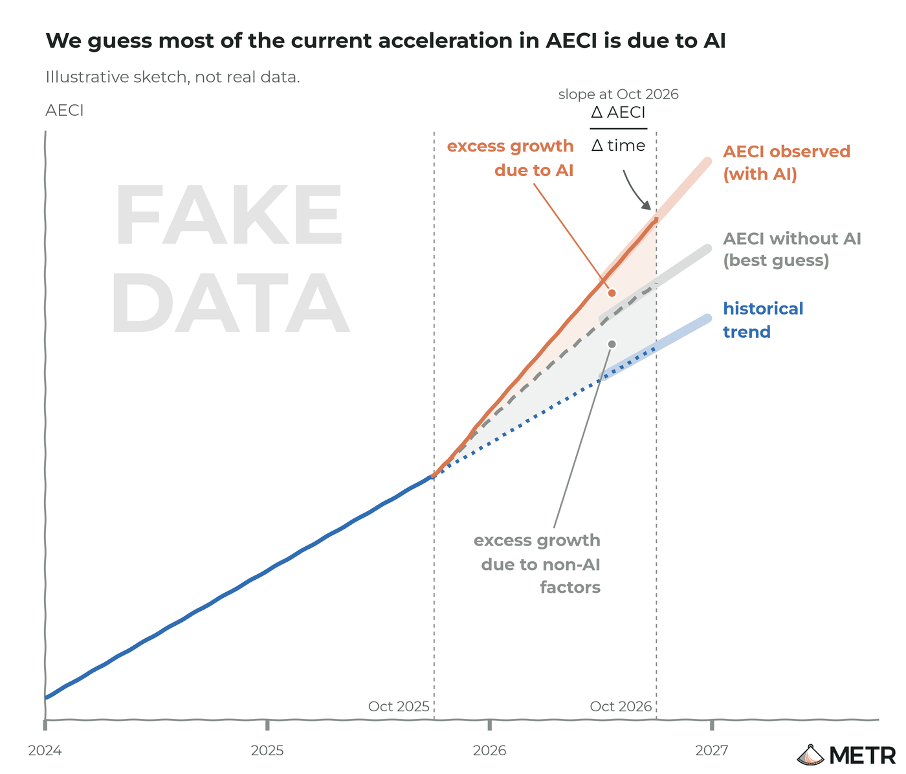
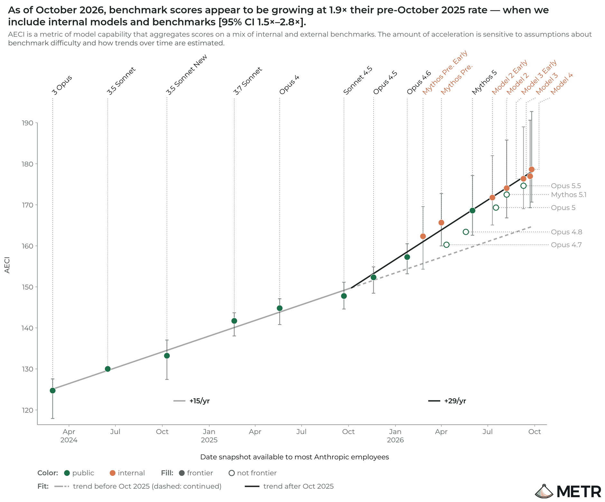
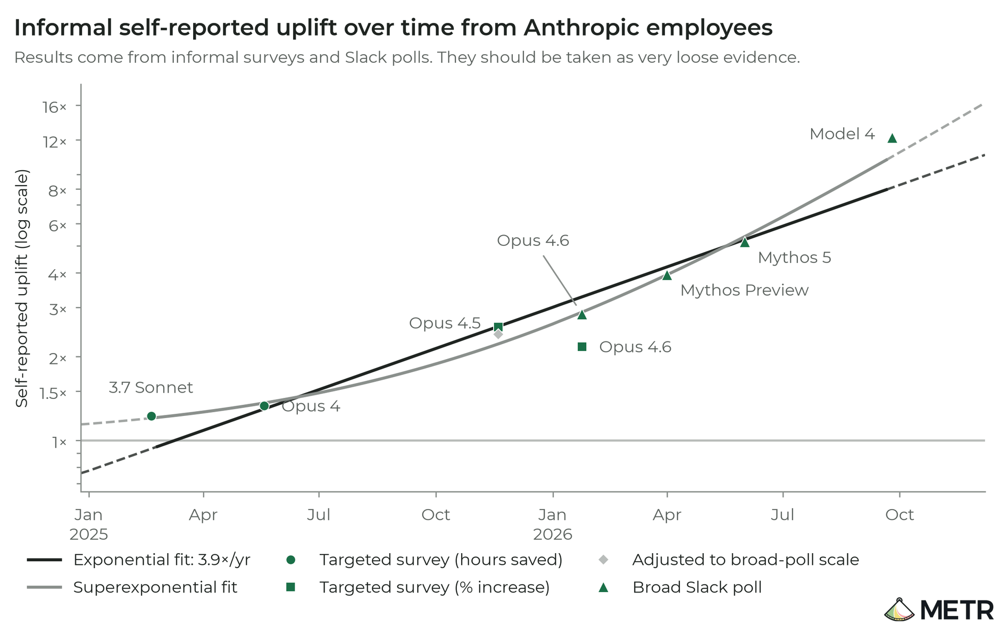
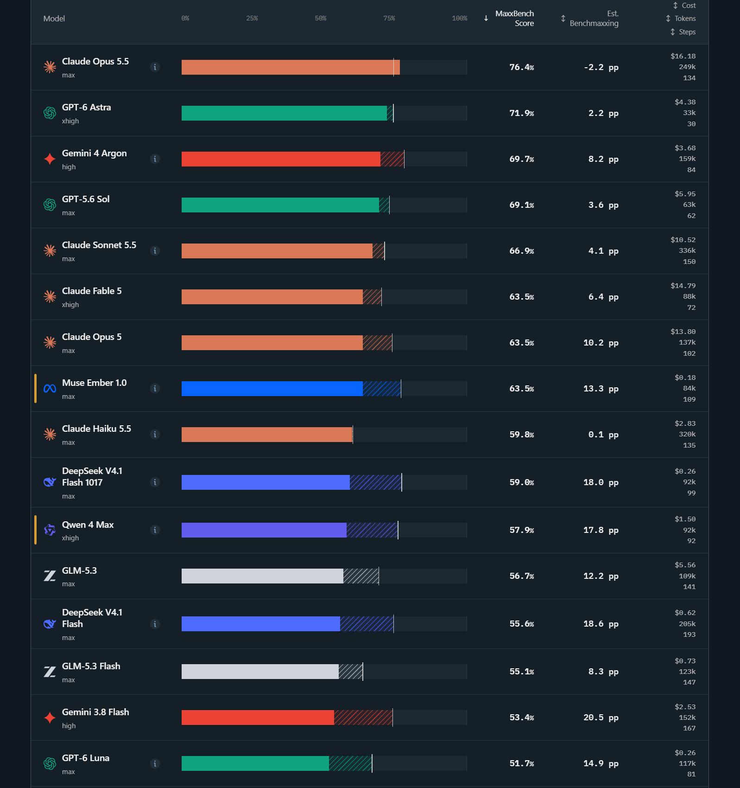

# 黎曼猜想之后，中国开源 AI 还能追上吗？

> 发布于 2026-11-24

我怀着复杂的心情写下这篇文字。成文很大程度上参考了 Theo 的视频[《If you like Open Models, I’m sorry》](https://www.youtube.com/watch?v=B2rFx4Fy1us)，也确实令我感同身受。

最近几天，AI 圈发生了一件令人震惊的事。11 月 20 日，Levent Alpöge 公布了他与 Claude 合作得到的黎曼猜想证明，次日由 Lean 社区确认了命题与证明。与此同时，在前沿数学上，开源与闭源 AI 之间的差距已经大得惊人。[Alpöge 的说明](https://alpo.ge/remark.pdf) · [Lean 社区的核验](https://leanprover-community.github.io/blog/posts/riemann-hypothesis/)

为了让平时不太频繁跟进 AI 最新进展的读者也能看清脉络，我们不妨把故事从今年 5 月说起。

## 从单位距离到黎曼猜想

5 月 20 日，OpenAI 公布了一个反例，推翻了 Erdős 对平面单位距离问题提出的 $n^{1+o(1)}$ 上界猜想。这是他们较早在公认具有一定重要意义的数学猜想上取得的成果。此后几个月，随着模型不断迭代，AI 的数学能力持续跃升：三维情形下 Jacobian 猜想的反例、六维球面上的复结构等重要问题，接连被证明或证否。[单位距离](https://openai.com/index/model-disproves-discrete-geometry-conjecture/) · [雅可比猜想](https://arxiv.org/abs/2608.00222) · [六维球面](https://cbirkbeck.github.io/hopf-s6-blueprint/Overview/The-problem/)

9 月 8 日，决定性的一击来了。OpenAI 公布了三维 Navier–Stokes 千禧年问题 C、D 两种情形的证明，并同时公开 Lean 形式化。这些证明分别在全空间和周期域构造光滑初值与外力，使题面要求的全局光滑解无法存在。10 月 6 日，OpenAI 又在 GitHub 上公布了一批数学预印本，其中部分结果附有形式化。[Navier–Stokes 公告](https://openai.com/index/navier-stokes-solution/) · [Lean 仓库](https://github.com/openai/NavierStokesAndEuler) · [10 月成果](https://github.com/openai/math)

11 月 20 日，Alpöge 发布了他与 Claude 合作得到的黎曼猜想证明，整个 Lean 库约有 1700 万行。次日，Lean 社区发布联合声明，宣称已经通过了形式化验证。[Alpöge 的原始说明](https://alpo.ge/remark.pdf) · [Lean 社区联合声明](https://leanprover-community.github.io/blog/posts/riemann-hypothesis/) · [独立核验记录](https://math.mit.edu/~drew/grh/)

人们过去之所以如此看重 AI 的数学能力，一方面是因为数学可以用 Lean 4 这样的工具闭环验证，另一方面，从人类学习数学的经验来看，对数学的掌控力很大程度上反映了一个人逻辑推理的严密性，更不用说它所带来的迁移能力。过往我们常常认为，数学最能考察一个人的纯粹智力，而许多工程领域所需的则偏向 know-how 型的领域知识。前者在思维上往往更加“本质”。

这正是当下顶尖 AI 所到达的位置。在黎曼猜想被解决的过程中，没人会否认 AI 发挥了至关重要且无法替代的作用；也没人会否认，以任何合理的标准来衡量，顶尖 AI 的数学能力都已经超越了所有普通人类和绝大部分数学家。

换句话说，如果沿用衡量人类的方式去衡量 AI，它如今欠缺的已经不是纯粹的智力。按数学标准来看，它已达到超人水准，而是各种各样的领域知识。这也是[这条推文](https://x.com/alexandr_wang/status/2124636606959345776?a=E7cE9PABoPwPE_PRQcw&s=46)所表达的核心观点。尽管这条推文是近日发布的，但在 Navier–Stokes 问题被解决之后，这一事实便已确凿无疑。

那么，开源 AI 又走到了哪一步？如下 Benchmark，一看便知。





| Epoch AI 评测 | 闭源模型 | 中国开放权重模型 |
| --- | --- | --- |
| FrontierMath Tier 4（v2） | GPT‑6.2 Astra 100%，Claude Fable 5.2 100%。实际上，GPT‑6.1 Sol 就已经完全解决了它 | DeepSeek‑V4.1‑Flash 26.8%，Kimi K3.1 Pro 66% |
| FrontierMath Erdős | GPT‑6.2 Astra 7/68，GPT‑6.1 Sol 3/68 | Kimi K3（7 月版）0/68 |

[GPT‑6.2 Astra 数据](https://epoch.ai/models/gpt-6-2-astra) · [Tier 4 榜单](https://ai.info/tracker/benchmarks/frontiermath-tier-4) · [Erdős 榜单](https://www.benchleader.com/benchmarks/frontiermath_erdos)

就算抛开这些 Benchmark，单看已公开的重大数学成果，中国的开源模型也已经落后很远。

## DeepSeek‑R1 到如今

甚至于，在我的感觉中，**DeepSeek‑R1 是我印象中开源模型最接近闭源前沿的时刻，甚至那一时刻略微超过了闭源 AI。随后它被闭源 AI 反超，而如今这道差距正在越拉越大。**事实上，倘若我们回忆当时的测试，DeepSeek R1 发布时，DeepSeek 在 AIME 2024 和 MATH‑500 上报告的分数都略高于 OpenAI o1‑1217。[DeepSeek‑R1 的评测](https://github.com/deepseek-ai/DeepSeek-R1#evaluation-results)

我想，我恐怕永远不会忘记 2025 年 1 月用上 DeepSeek R1 时的感受。我当时问了它：

```text
User:
How many r's are there in "strawbery"
```

这里我故意把单词拼错了，结果 DeepSeek 陷入到了循环之中。它开始怀疑这是不是用户在测试它，到底应该回答 2 还是回答 3，然后就无尽地思考下去。

现在如果我们看到这种情况，只会认为这是 AI 出现了 Bug，认为这是 AI 陷入到了“雷霆大思考”的状态。但是当时我却有一些震撼乃至于一些恐惧，好像 AI 也具有了某一些非常类似人类的行为。

是的，自此之后，我从未感觉到开源模型有如此接近过闭源 AI。接下来我们会论证为什么差距在扩大，以及为什么如果保持现状不变，差距只会越来越大。

## 算力、RSI

最大也最根本的原因，毫无疑问是算力。中国的人才和天才的数量绝不会少于美国的 Frontier Lab，但是他们能够分配到的算力资源，在中国却远远少于美国。

正好，有人最近从 OpenAI 2023 年 GPT‑4 发布页的图表源码里找到了归一化前的算力数据。他们按 PF‑day 换算，得到 GPT‑4 的训练量约为 $1.235\times10^{25}$ FLOP。如果不知道这个数据是什么概念，我们可以和 Epoch AI 对 DeepSeek‑V4‑Pro 的估算（$9.7\times10^{24}$ FLOP）放在一起比较，它们处于同一个量级。

可是 GPT‑4 已经是 2023 年的模型了，DeepSeek‑V4‑Pro 则是 2026 年的。如今，Epoch AI 对 GPT‑6 Astra 的估算则是 $9.4\times10^{26}$ FLOP，约为 DeepSeek‑V4‑Pro 的 97 倍。[GPT‑4 发布页](https://openai.com/index/gpt-4-research/) · [图表源码与换算](https://ridgerzhu.com/gpt4-scaling-ladder/) · [DeepSeek‑V4‑Pro](https://epoch.ai/models/deepseek-v4-pro) · [GPT‑6 Astra](https://epoch.ai/models/gpt-6-astra)

也就是说，仅做一个简单估算，当前中国 AI 实验室和顶尖 Frontier Lab 之间的算力差距已经达到 2 个数量级。

如果不清楚这意味着什么，不妨回看机器学习（ML）领域的过往。AlphaZero 问世后，KataGo 的论文报告用约五十分之一的计算量达到了与所比较方法相近的学习目标。DeepNash 发布后，Ataraxos 把自博弈局数降到了约三十分之一。我们只需看看论文里需要的 Trick 数量，就知道这是何等费力的事。同时，归根结底，前者是从 0 到 1 的突破，后者是从 1 到 10 的优化。后者当然很有价值，但我们很难想象它先于前者出现。[KataGo 论文](https://arxiv.org/abs/1902.10565) · [Ataraxos 论文](https://www.nature.com/articles/s41586-026-11036-y) · [Ataraxos 与 DeepNash 的比较](https://www.cs.cmu.edu/~sandholm/cs15-888F26/L12_deep_rl.html)

在 AI 实验室里，逻辑是相通的。更多的算力意味着可以并行更多实验、训练更大的模型，也意味着在未知方向上有更多试错的机会。

如果说这样的差距已经十分巨大，那么接下来的事情只会让差距再次扩大。这就是 RSI。

AI 已经在加速 AI research，这是毫无疑问的。[METR 的评估](https://metr.org/blog/2026-11-05-anthropic-ai-rd-acceleration-assessment/)





如上图，METR 估计，截至今年 10 月，Anthropic 在定义清晰的任务上提升模型能力的速度，已经接近 2024 年 3 月到 2025 年 10 月的两倍。

同时，在他们进行的一项非正式员工自我报告中，员工对于 AI 提升其工作效率的幅度估算达到了超指数的速度。注意，下面这幅图是在 log scale 上绘制的非线性图表。



总而言之，这样的趋势无疑会让先有优势的一方积累起更多的优势。

与此同时，闭源模型积累了更庞大的用户群，借此收集到更多真实数据，从而更有可能训练出下一代更强的模型。反观开源阵营，为了获取数据，往往还只能拿到普通的 rollout，拿不到真正的 reasoning trace，只能采用使用中转站收集数据、进行蒸馏，乃至更加恶意的操作。

> **提示** 关于蒸馏，我们有相当明确的把握，除了 Anthropic 和 OpenAI 的报告之外。7 月中旬，有用户通过 OpenCode 调用 DeepSeek 官方 API，发现部分会话的思维链变成了类似 Claude 的分段摘要，早期响应里的系统指纹也与当时公开的 V4 不同。7 月 20 日的社区记录还汇总了小样本指纹测试，其中一些高频回答与 Claude 的部分型号重合。在 [WitchAI](https://www.whichai.dev/) 上，我们甚至能够比较清晰地感觉出他们蒸馏的是什么模型，例如 Kimi K3.1 Pro 和 GPT‑6 Astra。[7 月 20 日的社区实测记录](https://www.cocoloop.cn/t/topic/12175) · [Anthropic 的报告](https://www.anthropic.com/threat-intelligence-report-september-2026)

且不说蒸馏正在变得越来越难，蒸馏本身追赶也有天花板。回到 RSI 的角度，Anthropic 的条款限制用户用 Claude 的输出训练竞品，而 Anthropic 内部已经在用 Claude 辅助研发更强的模型。外部团队能蒸馏的是它们能接触到的模型输出，内部团队能直接用最新的内部模型做研究。这样下去，差距没有理由不被拉大。[Anthropic 的条款说明](https://support.claude.com/en/articles/12326764-can-i-use-my-outputs-to-train-an-ai-model) · [METR 的内部研发评估](https://metr.org/blog/2026-11-05-anthropic-ai-rd-acceleration-assessment/)

与此同时，还有一种令我厌恶的风气，有意或者无意的 _benchmaxxing_。以下的 Benchmark 可以解释之前一部分现象，AA 上为什么之前的 Google 和一些开源模型看起来分数很高，实际上用起来非常不可用。

MaxxBench 把 DeepSWE 的任务做了一些修改。DeepSeek‑V4.1‑Flash‑1017 的成绩从 77.0% 掉到 59.0%，Claude Haiku 5.5 从 59.9% 变成 59.8%。用这样的跑分来炫耀模型在实际使用中有多强，在我看来与作弊无异。[MaxxBench 的对照成绩](https://unlap.ai/maxxbench/)

我理解这样做也许可以获得更多的资金，但是这并不意味着这是更好的产品。

此外，另一个使人担心的情况是，如果研究人员养成了“蒸馏”的路径依赖，花费更多的精力研究如何从顶尖闭源模型上蒸馏，而不是研究如何开发新的算法，如何做更好的 RL 环境，获取更好的数据，那么我们便无法认同这样的模式能够长久诞生出真正好用的模型。



## 下一次 R1 会从哪里来？

如果我们回顾以上的两点最核心的因素，算力和 AI 辅助的加速，任何一环在短期内都看不到缓解的可能，反而有不断扩大的倾向。

试想，算力让实验室能同时试更多方向，更强的内部模型开始帮忙加速推进下一轮值得跑的方向。**这两种优势会相互放大。**有更多算力的团队可以让更强的模型参与更多实验，而模型越能干，同一批算力就可能产出越多有价值的结果。

这样一来，即使另一个团队追平了今天公开的模型，领先者也已经用它的内部模型做了一轮研发。

回顾下来，开源 AI 的现实确实令人悲观。我真心希望自己的判断是错的，也真心期待开源界能拿出令人振奋的成果。

只是眼下的局面，实在让人无法乐观。


