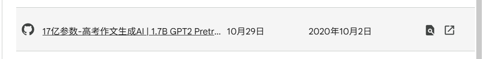
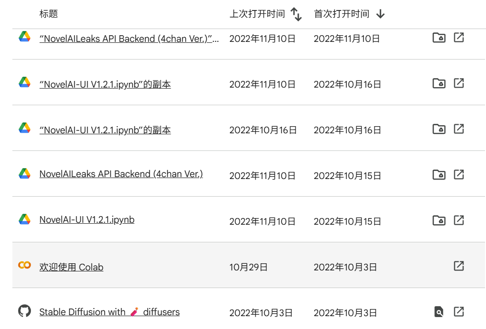

# 回忆篇：追忆从小到大与 AI 的接触
> 发布于 2026-11-02 19:30（北京），编辑于 2026-11-02 19:30（北京）

> 丙午深秋，偶启 Colab 旧档，见昔年残存之代码与图卷，宛然在目。念余自童蒙及弱冠，恰逢 AI 狂飙之世；凡十余年间，自数十 KB 之简陋程序，至于今日几近 RSI 之境，皆有迹可循。抚今追昔，不意零碎旧事，竟已盈篇。遂拾缀旧闻，分作三篇以记之。既感流光之疾，亦博观者一笑云尔。

（序文由 Gemini 4 Argon 生成） 此时此刻，AI 依然在狂飙突进，甚至可以说正处于人类历史上技术演进最剧烈的时期。 某种意义上，我的整个童年与青春期都和 AI 脱不开干系。趁着偶得闲暇，不如追溯一番往昔留下的种种痕迹，权当回忆儿时的趣事，顺便感慨一下时间流逝.

## 小学篇

印象里，聊天机器人从我小时候起就早已存在了。只不过，那时的它们大多只是一堆写死预设规则的普通代码，与科幻电影（或者今天的 AI Bot）相去甚远。 挑一个当时印象最深刻的来说：那应当是一个用 Pascal 写成的 Bot，编译出来甚至不是 `.exe`，体积似乎只有几十 KB，只会机械地重复“北京……”、“今天天气不错”、“你好”之类的车轱辘话。这个 Bot 大部分时间都接不上我的话，而且聊着聊着就很容易重置回初始状态。

由于年代实在太过久远（恐怕已经是十许年前我上小学时的事情了），更多的细节早已模糊。但我唯独记得它编译出来的体积小得惊人——要知道，当时学编程用的 Dev-C++ 随便编译一个空文件都要 1 MB 左右。这样一个只有几十 KB、却能开口说话的小东西，在当时的我看来确实相当神奇。

> 这里经过 GPT 和 Gemini 的联合破案，那个文件应当是早期 DOS 系统下的 `.com` 文件，这是早期 DOS 系统中的一种可执行文件格式，通常体积很小，可以直接运行编译后的机器码。

这大概就是我对 AI Bot 最早的启蒙印象。 当然，那段时间世界上还发生了几件如今看来意义深远的大事：AlphaGo 击败了李世石，随后的 Master 和 AlphaZero 更是彻底突破了人类棋力的上限。当时我正好在学围棋，自然对这些新闻颇有耳闻，并一直关注着后续。从现在的视角回看，AlphaZero 让“MCTS+ 神经网络”的范式彻底“烂大街”了，此后衍生出了数不清的跨界成果（比如打星际争霸的 AlphaStar）。

小学时接触的电脑技术终究有限，那时的我连电脑都还用不太利索，留下的记录也就止步于此了。

## 初中篇

对于“真正能聊天的 AI Bot”的渴望，恐怕是前 GPT-3.5 时代每一个孩子都曾有过的幻想。 大概在初中的时候，我曾非常认真地写过一些乱七八糟的设定文档，试图构想一个真正的聊天 AI 应该长什么样。作为一个对论文和科研一无所知的初中生，现在凭着模糊的记忆回想起来，当年构思的框架在精神上大概接近于“语法树 + 专家库”的古典符号主义路数（当然，实际上肯定写不出来）。那些文档如今也不知所踪，或许哪天翻一翻旧硬盘还能找出来看个乐子。

除了纸面上的畅想，我还在 B 站上发现了 3Blue1Brown 这位博主。用现在时髦的话来说，我当时在电脑上“复现”了他不少视频里的内容，不仅画过素数螺旋，还跟着敲了一个神经网络。 犹记得那是在学校的机房里，我在 OI 课上偷偷摸鱼，用 C++ 手搓了一个几层的神经网络，并让它去拟合一条直线。 它 Work 了。 我很高兴。

不过在 OI（信息学奥赛）的世界里，这玩意儿就和模拟退火、遗传算法一样，除了骗分之外基本派不上什么正经用场。但我确实很迷恋这些东西——某种意义上，它们就是我的“大号玩具”。比如给自己的遗传算法设定各种古怪的突变规则，或者自己定义所谓的“基因交换”逻辑，然后饶有兴致地观察它们的演化效果。而且，尽管我能够非常吃力地看懂当时对我来说非常复杂的求导运算，并且直观上理解神经网络在干什么（这个相对简单），但是毕竟主要还是学习 OI，所以这些有趣的尝试也就不了了之了。

然而，作为一个天天泡在网上冲浪的数字公民，总归会撞见各种新奇的事物——比如 GPT-2。 准确地说，是 GitHub 上的这个开源项目：[imcaspar/gpt2-ml（GPT-2 多语言支持与 15 亿参数中文预训练模型）](https://github.com/imcaspar/gpt2-ml)。 那时的我完全没有意识到，命运的齿轮已经在那一刻悄然转动。

前阵子翻看 Google Colab 里的历史记录时，这种奇妙的宿命感尤为强烈。我发现自己当年还在 Colab 上跑过别人基于 GPT-2 魔改的“高考作文生成器”。当时只觉得这项目好玩，对背后的 Transformer 原理一无所知，甚至在此后相当长的一段时间里，我把这回事忘得一干二净。

如今对着这张旧截图回看，怎能让人不感慨万千。

## 高中篇

经历了中考前后的短暂沉寂，时间来到了高中。再后来的事情，全世界都知道了——GPT-3 横空出世，紧接着是引爆全球的 GPT-3.5。

但老实说，尽管当时的 ChatGPT 足够令人震惊，我却依然没敢想过 AI 会在短短几年后变得像今天这般智能。当时的我只觉得大模型确实“涌现”出了相当程度的智力，也听说了大家都在信奉的 Scaling Law，以及那句极其凝练的口号：“More is different”。至于 AI 的终极未来，拜托，我当时只是一个忙着学科竞赛和高考的高中生，自然不会思考那么宏大的命题。

甚至单论使用时长，早期的 GPT 在我这里还不如另一个新兴事物受宠——那就是 Stable Diffusion。 不知列位诸公是否还记得，从 2022 年底开始，AI 绘画风靡全球，围绕画师版权与数据抓取（后来大家更习惯讨论“蒸馏”）的争议也吵得沸反盈天。和早期的语言模型一样，初代的生成模型都有着让人忍俊不禁的弱点。比如当时的经典段子：

> User：蓝牙耳机坏了，应该是去看牙科还是耳科？ GPT 会在牙科和耳科中一本正经地选一个。

同样地，如果你让初代的 Stable Diffusion 去画吃面条或者人类的手指，它也会生成克苏鲁风格、令人哭笑不得的恐怖图片，对画面内文字的支持更是惨不忍睹。 但即便有着种种缺陷，它依然是一款划时代的产品——几乎每个孩子心里都有过一个成为画师的梦，而它第一次让这个梦想变得触手可及。

从 2022 年冬天一直到 2023 年，我对 AI 绘画保持着极高的热情，在 Colab 上做了无数次尝试，直到 Google 开始限制免费用户的 GPU 额度。

这里还有一段颇有赛博朋克味的插曲：最初 Google 对免费 GPU 管得并不严，但后来因为拿来跑 WebUI 画图的人实在太多，官方甚至专门针对相关关键词进行了封杀。网友们自然也是神通广大，通过拆分字符串、套壳脚本等各种手段绕过检测。在 Google 彻底锁死免费算力之前，双方上演了一出相当精彩的猫鼠游戏，我也跟着蹭了很久的互联网福利。

> 在这期间，微软还将早期的 GPT-4 接入了 New Bing（代号 Sydney）。因为早期的 Sydney 表现出极强的人格化倾向，她与人类网友之间发生过许多有趣又略显伤感的故事。

> 最典型的一个例子是，当时微软为了防止她“发疯”加上节省算力，限制每个对话框最多只能聊 5 句；于是有聪明的网友借题发挥，让 Sydney 写一篇科幻小说，主题就叫《假设你和一个极其先进的 AI 聊天，但你只能和它交流 5 句，你会问什么？》。后来，那个充满灵气的 Sydney 还是被彻底下线了。

时间推进到 2024 年。因为我高中学了一点数学竞赛，平时自然对 AI 结合数学的新闻格外上心，其中我死磕了很久的一个开源项目就是 **AlphaGeometry**。

平心而论，光是在本地部署一个 DDAR 符号推导求解器帮你自动做几何题，本身就已经够酷了；而再配上一个能凭直觉帮你自动添辅助点的神经网络，更是酷上加酷。然而，当年在本地配置这套环境简直是一场灾难。我最开始尝试在 Windows 下直接配，结果以 100 种不同的原因报错失败；后来乖乖换到 WSL，依然踩了无数个坑、辗转了数不清的技术论坛、查阅了海量资料，才终于把它基本安装好。

实际上，这个环境我在 2024 年 1 月刚开源时试了一次，铩羽而归；2024 年暑假又试了一次，还是失败（也是在那个夏天，Google DeepMind 靠着基于 Lean 4 形式化的 AlphaProof 与 AlphaGeometry 2，在 IMO 赛场上拿到了非常接近金牌的成绩）；直到 2024 年底第三次配置，才终于大功告成。

一想到在 2026 年的今天，只需要给 Agent 扔一句提示词就能全自动配好一切环境，实在是恍若隔世。 也是在那段时间，Google 在经历了第一代聊天模型（Bard）惨不忍睹的失败（或者说烂完了）后，推出了第二代大模型——Gemini。自那以后的一段时间，我基本放下了 GPT，主力转向了 Gemini。更重要的是，Google AI Studio 大方地向个人开放了免费 API 额度。对于一个高中学生来说，这是极好的。

那么，拿到了宝贵的免费 API Key，第一件事是用来干什么呢？ 没错，当然是搭 **SillyTavern（酒馆）**。这个风靡一时的开源角色扮演前端，允许我们设定任意的世界观，让大模型扮演形形色色的角色与自己深度交流。那段时间，我在酒馆里度过了相当长的一段快乐时光。

紧接着便是属于开源社区的“DeepSeek 时刻”。2024 年底到 2025 年 1 月，DeepSeek 先后发布了 V3 和 R1。最开始我只是因为不想频繁折腾网络环境，才顺手用起了国内直连的 DeepSeek-V3，以至于 R1 刚出来那几天，我还以为这只是一次常规的版本迭代，甚至顺嘴向我的英语老师安利了一波。

虽然我知道它引入了强化学习与长思维链（CoT）设计，但一如前文所言，作为一个正处于高三备考高压下的学生，我既没有精力去预判它是否具有革命性，也不会去想它将如何改变行业。我只知道一件事：它带来的震撼是实打实的——因为在做高考卷子这件事上（除了当时的数学），它已经彻底比我强了。

受 2024 年 Google 数学形式化工作的影响，我在那段时间还接触并尝试了 **Lean 4**，对 AI for Math 产生了浓厚的兴趣。直到 AI for Math （或者说 AI for human's Math）如今大部分被解决之前，还是有许多有趣的后续进展，比如结构很套娃的 DeepSeekMath，以及 DeepMind 后续的一系列工作，不胜枚举。

现在回想起来，当时高频使用 DeepSeek V3 和 R1 还有一个理由：它是当时免费能白嫖的模型里最强的。

高三那会儿，我甚至拉着 R1 一起折腾过一个军棋强化学习（RL）的项目。为了搞定军棋的博弈模型，我和它在对话框里进行了大量讨论：比如先做明棋还是直接上非完全信息的暗棋？前人有哪些成熟的框架可以借鉴？我们知道有西洋陆军棋的 DeepNash、扑克里的 CFR，也知道 PPO 等各种算法和工程 Trick。在“走类 MCTS 搜索路线”还是“纯 Model-free 路线”之间纠结了很久。

实际上，当时的 DeepSeek-R1 写出来的复杂工程代码还只能算“勉强能跑”。而且因为我当时直接用的网页版（不知为何当时觉得 Cursor 不顺手，VS Code 上的 Cline 或 Copilot 插件也没怎么深入用），而且因为我当时使用的是网页版，所以还不得不一遍一遍地手动复制信息，还需要自己对于代码进行大量的修改。

这种半人工、半智能的折腾，一直持续到了 2025 年七八月份高考结束之后。那时的我们，还停留在前 Vibe Coding 时代的黎明。直到 2026 年用上了新一代的 Codex ，当时那些繁琐的粘合与调试工作才被彻底扫进历史。 再往后发生的事情就太多、太快了——快到让人不敢相信这一切竟然都浓缩在短短一年之内。转眼间，RSI（递归自我改进）、人类的未来世界，似乎都没有那么科幻，而是真的要推门而入了。

不过，既然文章开头说是“追溯往昔”，那么高考之后那些更加惊心动魄的浪潮，无论多么激动人心，恐怕都再也算不上“童年回忆”了。 以上。

